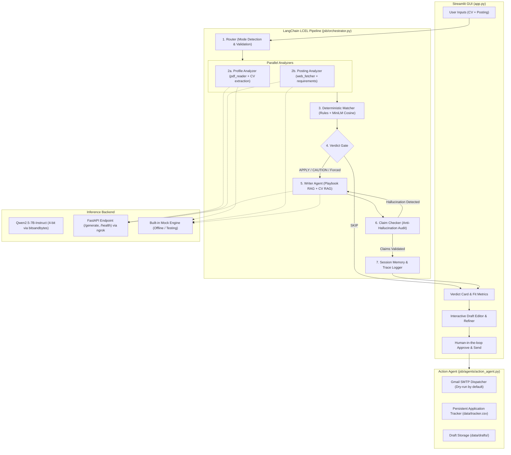

# JSBrother (Job Seekers' Brother) 🤝

[](https://www.python.org/downloads/)
[](https://python.langchain.com/)
[](https://github.com/facebookresearch/faiss)
[](https://streamlit.io/)
[](https://huggingface.co/Qwen/Qwen2.5-7B-Instruct)
[](file:///tests)

> **JSBrother** is an intelligent, multi-agent AI copilot designed for **Job Seekers** (crafting tailored, high-converting cover letters) and **Freelancers** (crafting targeted, winning proposals).
> 
> It autonomously parses CVs and job postings, computes an objective fit score (0–100), issues a deterministic **APPLY / CAUTION / SKIP** verdict, fact-checks every generated claim against source documents to prevent hallucination, and provides a safe human-in-the-loop execution pipeline.

---

## 💡 Core Philosophy

```
  ┌──────────────────────────────────────────────────────────────┐
  │  Python computes the score and the verdict.                  │
  │  The LLM only extracts, explains, and writes.                │
  └──────────────────────────────────────────────────────────────┘
```

1. **Deterministic Scoring & Verdicts**: The LLM is never allowed to hallucinate a candidate's suitability or override verdict boundaries. Strict Python business logic evaluates must-haves, deal-breakers, budget, and experience.
2. **Zero-Hallucination Anti-Audit Gate**: Every claim in the generated draft is cross-verified against the candidate's actual CV using semantic similarity and substring verification. Unsupported claims trigger automatic regeneration.
3. **Human-in-the-Loop Safeguards**: No email or application is ever dispatched without explicit user review, manual editing, and approval. Dry-run mode is enabled by default.
4. **Dual-Mode Operation**: Dedicated analysis pipelines for corporate job seekers and freelance project bidders.

---

## 🚀 Key Features

| Capability | Job Seeker Mode 💼 | Freelancer Mode 🛠️ |
|---|---|---|
| **Input Source** | PDF CV + Job posting (text/URL) | Candidate Profile + Project description |
| **Analysis Focus** | Must/Nice skills coverage, years of experience, deal-breaker verification | Skill fit, budget compatibility, deadline feasibility, vague scope detection |
| **Scoring Formula** | Must-Have (60%) + Nice-to-Have (20%) + Experience (20%) | Must-Have (55%) + Nice-to-Have (15%) + Budget (15%) + Deadline (15%) |
| **Output Artifact** | Tailored Cover Letter / Application Email | Tailored Proposal (Problem, Solution, Timeline, Pricing) |
| **Action Pipeline** | Gmail SMTP dispatch (after approval) + CSV Tracker logging | Instant copy/download + optional email + CSV Tracker logging |

---

## 🏛️ System Architecture

JSBrother connects a Streamlit frontend with a LangChain LCEL pipeline, backed by FAISS vector retrievers and a remote 4-bit quantized LLM server (with a zero-cost local mock mode for development).



---

## 🧠 The Six Autonomous Agents

All tools are implemented as LangChain `StructuredTool` instances:

1. **Router Agent (`router.py`)**: Detects operational mode (`job` vs. `project`), validates inputs, and initializes the LCEL pipeline.
2. **Profile Analyzer (`profile_analyzer.py`)**: Converts raw CV documents (PDF/text) into structured `ProfileJSON` (skills, roles, years of experience, education).
3. **Posting Analyzer (`posting_analyzer.py`)**: Extracts structured `PostingJSON` (must/nice skills, deal-breakers, budget, deadline, vague scope flag) with retry mechanics.
4. **Matcher Agent (`matcher.py`)**: Plain Python deterministic rules engine with skill alias mapping and `all-MiniLM-L6-v2` semantic fallback. Computes scores and verdicts.
5. **Writer Agent (`writer.py`)**: Synthesizes tailored cover letters and proposals using dual FAISS retrievers (copywriting playbook + candidate CV).
6. **Claim Checker (`claim_checker.py`)**: Audits draft claims against candidate facts before presenting to the user, enforcing 0 hallucinations.
7. **Action Agent (`action_agent.py`)**: Executes approved actions: sends emails via Gmail SMTP and appends detailed records to `data/tracker.csv`.

---

## ⚖️ Deterministic Verdict Logic

Verdicts are evaluated strictly in the following sequence:

| Priority | Rule Condition | Verdict |
|:---:|---|:---:|
| **1** | Any demonstrable deal-breaker failure (e.g., candidate years < required minimum) | **SKIP** |
| **2** | Score `< 50.0` OR missing `≥ 3` must-have requirements | **SKIP** |
| **3** | Score `≥ 75.0` AND zero missing must-haves | **APPLY** |
| **4** | Moderate fit score (`50.0 - 74.9`) or non-critical gaps | **CAUTION** |
| **5** | Freelancer mode: `budget_fit == 0` or `vague_scope == True` | Downgrades APPLY to **CAUTION** + adds red flag |

> **Note**: On **SKIP**, JSBrother shields the user's time by withholding draft generation by default, displaying only the analysis card and an optional *"Apply anyway"* button.

---

## 📊 Benchmark & Evaluation Results

Tested on both synthetic control benchmarks and real postings from LinkedIn & Upwork:

| Metric | Target | Achieved Result | Status |
|---|---|---|:---:|
| **CV Core Skill Recall** | $\ge 80\%$ | **$96.6\% - 100\%$** across test CVs | ✅ Exceeded |
| **Posting Requirement Recall** | $\ge 80\%$ | **$100\%$** on synthetic test benchmarks | ✅ Exceeded |
| **Hallucination Rate** | 0 flagged claims | **0 flagged claims** in evaluated drafts | ✅ Perfect |
| **Unit Test Coverage** | Clean test suite | **63 / 63 tests passing** | ✅ Verified |
| **Execution Safety** | 100% human approved | 100% dry-run & explicit approval barrier | ✅ Secured |

---

## 🛠️ Tech Stack

- **LLM**: Qwen2.5-7B-Instruct (4-bit bitsandbytes quantization) hosted on Google Colab / Kaggle T4 GPU.
- **Serving**: FastAPI + Uvicorn exposed via authenticated ngrok tunnel.
- **Orchestration**: LangChain LCEL (LangChain Expression Language).
- **Embeddings & Vector Store**: `sentence-transformers/all-MiniLM-L6-v2` + FAISS index.
- **Frontend**: Streamlit with custom **Midnight Aurora** dark palette (`#0F1220`, `#6C5CE7`, `#00B8D9`).
- **Parsing**: `pypdf` for PDF CV ingestion, `BeautifulSoup4` for web posting extraction.
- **Testing**: `pytest` comprehensive test suite.

---

## ⚡ Quick Start Guide

### 1. Prerequisites & Environment Setup

Clone the repository and install dependencies:
```bash
git clone https://github.com/<your-username>/<your-repo-name>.git
cd <your-repo-name>

# Create and activate virtual environment
python -m venv .venv
# On Windows:
.venv\Scripts\activate
# On Linux/macOS:
source .venv/bin/activate

# Install required dependencies
pip install -r requirements.txt
```

### 2. Configure Environment Variables

Copy the example environment configuration:
```bash
cp .env.example .env
```

Edit `.env` to configure your settings:
```env
# Set to 'mock' for instant offline testing without GPU resources
# Set to 'remote' to connect to the Colab/Kaggle GPU server
LLM_MODE=mock

# Remote LLM Endpoint (required only if LLM_MODE=remote)
LLM_BASE_URL=https://your-ngrok-subdomain.ngrok-free.app
LLM_API_KEY=your-secure-api-key

# Email Dispatcher Configuration (Optional)
SMTP_HOST=smtp.gmail.com
SMTP_PORT=587
SMTP_USER=your_email@gmail.com
SMTP_APP_PASSWORD=your_gmail_app_password
EMAIL_DRY_RUN=true
```

> 🔒 **Security Note**: Never commit `.env` to version control. It is pre-configured in `.gitignore`.

### 3. Running the LLM Server (Optional for Remote Mode)

If you wish to use the real Qwen2.5-7B model:
1. Open [`llm_server/kaggle_server.ipynb`](file:///llm_server/kaggle_server.ipynb) on Google Colab or Kaggle.
2. Ensure GPU acceleration (T4 GPU) is enabled.
3. Configure your `NGROK_AUTHTOKEN` and `LLM_API_KEY` in the notebook secrets.
4. Run all cells to launch the FastAPI server.
5. Copy the public ngrok URL to `LLM_BASE_URL` in your local `.env`.

### 4. Launch the Web Interface

Start the Streamlit application:
```bash
streamlit run app.py
```
Visit `http://localhost:8501` in your browser.

---

## 🧪 Running Automated Tests

Run the full pytest suite to verify all agents, scoring formulas, and anti-hallucination guards:
```bash
pytest tests/ -v
```

---

## 📁 Repository Structure

```
├── app.py                      # Main Streamlit web application
├── config.py                   # Global thresholds, scoring weights, and paths
├── requirements.txt            # Project dependencies
├── .env.example                # Template for environment variables
├── ARCHITECTURE.md             # In-depth architectural specification
├── PROJECT_CODE_EXPLANATION.md # Detailed codebase walk-through
├── demo_walkthrough.ipynb      # Step-by-step Jupyter notebook demo
│
├── jsb/                        # Core JSBrother Python package
│   ├── orchestrator.py         # LangChain LCEL pipeline orchestration
│   ├── schemas.py              # Pydantic v2 data models
│   ├── llm_client.py           # Robust HTTP client with retries & mock engine
│   ├── skills.py               # Skill normalization, alias registry & MiniLM
│   ├── memory.py               # Conversation buffer & session state memory
│   ├── gui_helpers.py          # UI gauge, metric badges & card renderers
│   ├── json_utils.py           # Robust LLM JSON parsing & recovery
│   ├── agents/
│   │   ├── router.py           # Mode routing & input validation
│   │   ├── profile_analyzer.py # CV parsing & ProfileJSON extraction
│   │   ├── posting_analyzer.py # Job/project requirement extraction
│   │   ├── matcher.py          # Deterministic scoring & verdict engine
│   │   ├── writer.py           # Cover letter & proposal RAG generation
│   │   └── action_agent.py     # Approval execution, email & logging
│   └── tools/
│       ├── pdf_reader.py       # PDF document parser
│       ├── web_fetcher.py      # Web scraping utility
│       ├── vector_store.py     # FAISS retriever for playbook & CV chunks
│       ├── claim_checker.py    # Anti-hallucination fact auditor
│       ├── email_sender.py     # Gmail SMTP dispatch integration
│       └── tracker.py          # CSV application audit log manager
│
├── llm_server/
│   └── kaggle_server.ipynb     # FastAPI server deployment notebook for Colab/Kaggle
│
├── assets/
│   └── style.css               # Midnight Aurora theme custom styling
│
├── data/
│   ├── playbook/               # Proposal & cover letter copywriting guide
│   └── samples/                # Benchmark CVs and test postings
│
├── scripts/                    # Evaluation and pipeline benchmark utilities
└── tests/                      # Automated test suite (63 unit tests)
```

---

## 🛡️ License

This project is licensed under the MIT License - see the LICENSE file for details.
